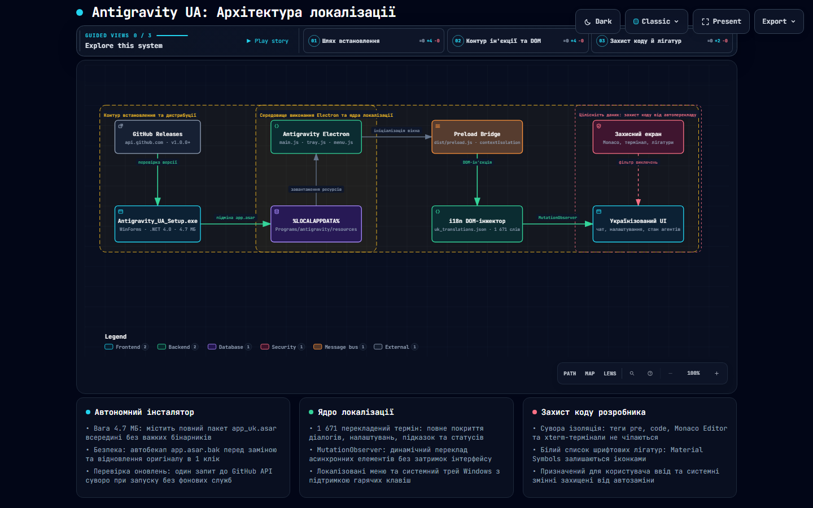

# 🇺🇦 Українська локалізація для Google Antigravity 2.0

Повний пакет українізації та автономний графічний інсталятор для AI-середовища розробки **Google Antigravity 2.0**.



Інтерактивна схема: [відкрити в браузері](https://riasj1dar.github.io/antigravity-ua/architecture.html)
(на GitHub файл показує код, не сторінку). Джерело схеми — `docs/architecture.json`.

---

## 🚀 Швидке встановлення

1. Завантажте **`Antigravity_UA_Setup.exe`** (~4.7 МБ).
2. Запустіть файл та натисніть кнопку **«Встановити українську локалізацію»**.
3. Інсталятор:
   - Автоматично перевірить запущені процеси та безпечно завершить їх;
   - Створить резервну копію оригіналу (`app.asar.bak`);
   - Встановить оновлений пакет української локалізації;
   - Запропонує запустити **Antigravity 2.0** з українським інтерфейсом.
4. Якщо ви захочете повернути оригінальну англійську версію, відкрийте інсталятор і натисніть кнопку **«⟲ Відновити оригінал (EN)»**.

Типова тека Antigravity — `%LOCALAPPDATA%\Programs\antigravity`; якщо програма стоїть деінде, шлях
можна змінити у вікні інсталятора. Замінюється файл `resources\app.asar`, оригінал лежить поруч як
`resources\app.asar.bak`. Перед заміною інсталятор закриває процеси `Antigravity` і `language_server`.

---

## ✨ Особливості локалізації

- **1,670+ перекладених сутностей інтерфейсу**:
  - Головне меню (*Файл, Редагування, Вигляд, Вікно, Довідка*).
  - Системний трей з правильною граматичною плюралізацією (*«1 агент працює»*, *«2 агенти працюють»*, *«5 агентів працює»*).
  - Бічна панель (*«Історія розмов»*, проєкти, навички, правила).
  - Панелі та статуси агентів (*«Планування»*, *«Виконання»*, *«Очікування на введення»*, *«Міркування»*, *«Готово»*, *«Помилка»*).
  - Повні описи та назви параметрів у панелі налаштувань (**Settings** — 114 реальних пар опцій).
  - Відносні мітки часу (`зараз`, `1 хв`, `2 год`, `1 дн` тощо).
  - Повний переклад плейсхолдерів полів вводу (*«Запитуйте будь-що, @ щоб згадати, / для дій»*).
- **100% збереження коду та терміналів**:
  - Блоки коду (`<pre>`, `<code>`, Monaco Editor), термінали (`xterm`) та призначений для користувача ввід суворо ізольовані та захищені від автоперекладу.
- **Захист шрифтових іконок**:
  - Лігатури Material Symbols (`.google-symbols`, `.material-symbols-outlined`, `.material-icons`, `.codicon`) занесені у білий список, завдяки чому іконки інтерфейсу залишаються ідеальними і не перетворюються на текст.
- **Сповіщення про оновлення при запуску**:
  - Перевірка наявності нових версій виконується лише один раз під час запуску інсталятора (без будь-яких фонових служб чи постійних процесів). Якщо на GitHub вийшла нова версія, інсталятор одразу виводить вікно з пропозицією завантажити оновлення.
- **Автономність**:
  - Інсталятор важить лише **4.7 МБ** і містить у собі весь необхідний модифікований пакет `app_uk.asar`, що дозволяє легко поширювати його без необхідності перепаковувати важкий 150 МБ бінарник програми.

---

## 📁 Структура проєкту

- **`docs/`** — архітектурна схема локалізації:
  - `architecture.json` — джерело істини системи (Archify v1).
  - `architecture.html` — інтерактивна SVG-візуалізація з підтримкою тем та навігації.
  - `architecture.png` — статичний знімок схеми для перегляду на GitHub.
- **`Antigravity_UA_Setup.exe`** — скомпільований автономний GUI-інсталятор (C# WinForms + embedded `app_uk.asar`).
- **`Installer.cs`** — вихідний код C# інсталятора (компілюється штатним `csc.exe` Windows).
- **`app_uk.asar`** — упакований архів локалізації Electron.
- **`uk_translations.json`** — джерело істини: словник українських перекладів (1,671 ключ).
- **`i18n_dom_injector.js`** — оптимізований DOM-інжектор для `preload.js` (TreeWalker + MutationObserver).
- **`wizardHtml_uk.js`** — локалізований майстер першого запуску IDE.
- **`asar_packer.py`** — пакувальник/розпаковувач ASAR на чистому Python (блоковий SHA-256 по 4 МБ, підтримка unpacked).
- **`chunks/`** — рядки інтерфейсу, поділені на 4 частини: `chunk_N.json` (оригінал) і `translated_chunk_N.json` (переклад).
- **`generate_dictionary.py`** — вбудований словник перекладів, який дописується в `uk_translations.json`.
- **`extracted_raw_strings.json`** — усі рядки, витягнуті з інтерфейсу (1533).
- **`clean_ui_to_translate.json`** — ті самі рядки без службових і шаблонних (1500).
- **`untranslated.json`** — рядки, які ще не мають перекладу.
- **`settings_pairs.json`** — назви параметрів налаштувань і їхні описи англійською.

---

## 🧰 Допоміжні скрипти

Потрібен Python 3, сторонніх бібліотек не треба.

```powershell
# розпакувати оригінальний архів Electron
python asar_packer.py unpack "$env:LOCALAPPDATA\Programs\antigravity\resources\app.asar" .\app
# запакувати теку назад; третій аргумент (необов'язковий) — тека файлів, що лишаються поза архівом
python asar_packer.py pack .\app app_uk.asar .\app.asar.unpacked
# дописати вбудований словник у uk_translations.json (наявні ключі не губляться)
python generate_dictionary.py
```

Окремого скрипта, який збирає `app_uk.asar` з цих файлів одною командою, у репозиторії немає.

---

## 🛠️ Ручна збірка інсталятора

Для збірки інсталятора з вихідних файлів використовується штатний компілятор Windows .NET:
```powershell
C:\Windows\Microsoft.NET\Framework64\v4.0.30319\csc.exe /target:winexe /out:Antigravity_UA_Setup.exe /res:app_uk.asar,app_uk.asar Installer.cs
```

---

## 📄 Ліцензія

MIT
